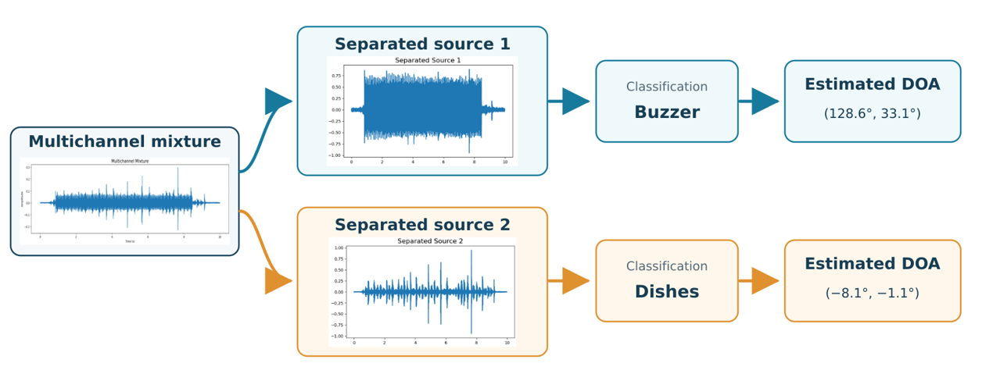

# Separation-Classification-and-Localization-of-Acoustic-Events-from-Multi-channel-Audio-Signals

This repository contains the Python code developed for my Diploma Thesis project, as well as the Thesis paper and presentation. In this Thesis we analyze complex acoustic scenes by developing a three-stage system for separating, classifying, and localizing overlapping acoustic events in multichannel audio mixture recordings. My Diploma Thesis conducted at the University of Thesally, Department of Electrical and Computer Engineering, under the supervision of Prof. Gerasimos Potamianos.

The project presents the design, development, and evaluation of this three-stage (separation, classification, localization) system using multichannel mixtures. It incorporates **audio processing and signal processing techniques, deep learning-based audio classification, audio source separation and localization.**

## Project Description
We will be using multichannel audio mixture recordings with a duration of 10 seconds in a .wav format, provided by the DCASE 2025 Task 4 Dataset. Each mixture is captured by four microphone channels, containing between 1 to 3 different acoustic events which occur simultaneously. Additional noise and interference sounds may be included into the mixtures. We focus mainly on the isolation of the individual sound sources on the mixture. This procedure takes place without any knowledge of the mixing process or the existing sources, which is called Blind Source Separation (BSS). Then, each isolated target sound event will be assigned a predicted label of an acoustic event class. Lastly,  we estimate the direction of arrival of each separated source signal, by exploiting the spatial information captured by the microphone array. 

## Features
This project can be divided into three parts:
- **Blind Source Separation**: The first task aims to recover a set of audio source signals from the observation of the multichannel mixture signal. The separation stage considers Indevendent Vector Analysis (IVA). The main assumption of the IVA algorithm is the statitiscal independence of the source signals and their spatial diversity across the microphone channels.
- **Acoustic Event Classification**: The separated signals will be fed into a Convolutional Neural Network (CNN) architecture in order to predict their class label. There is a total of 18 acoustic event classes which differ in duration, intensity, spectral content, and temporal structure, making the classification problem extremely challenging. The CNN model has been trained on predefined clean target source signals from each class, provided by the DCASE 2025 Task 4 Development Dataset.
- **Acoustic Source Localization**: We estimate the spatial direction of each separated source signal, by exploiting the spatial information captured by the microphone array. The estimation of the direction of arrival of each source is computed in terms of azimuth and elevation coordinates. Localization is not treated as an independent processing step. In contrast, it is recovered from the separated outputs by exploiting the spatial information obtained during the preceding source separation stage.

## Repository Structure
All folders contain the Python code developed for the experimental part of each of the three stages.
| Path | Contents |
| --- | --- |
| [`separation`](separation/) |Complete methodology of the IVA algorithm by creating a class, in order to produce the separated signals through the multichannel mixture. Contains also the main executive program that runs the IVA class. |
| [`classification`](classification/) |CNN architecture using Tensorflow/Keras and audio data preprocessing for the classification of the separated signals. |
| [`localization`](localization/) |Exploits the spatial information obtained by the IVA algorithm, leading to the computation of the direction-of-arrival cordinates. |
| [`evaluation`](evaluation/) |Contains the code for the evaluation separation metrics that have been used (SDR, SNR, SAR).|
| [`Moirotsos_georgios.pdf`](Moirotsos_georgios.pdf) | Project report with fundamental concepts about audio source separation, classification, and localization, methodology, experimental results and conclusions. |
| [`Thesis_presentation.pptx`](Thesis_presentation.pptx) | Project final presentation. |
| [`complete_pipeline.png`](complete_pipeline.png) | Project complete pipeline. |

## Complete Pipeline
Here is an example from a multichannel mixture of the evaluation dataset which represents the complete pipeline of this Thesis, starting by decomposing the separated source signals from the mixture, then classifying the source signals and, lastly, estimating their direction-of-arrival coordinates relatively with the microphone array.

## Disclaimer
All of the work was done locally on my machine, so every path written should be checked before it can be reused. For a large amount of mixtures, the experiments refered to the IVA algorithm and the extraction of the separated signals have taken place by using the EuroHPC resources, making the experiements much faster than running them locally. My code and workflow can be further optimized for better performance, but the purpose of this project was to develop a three-stage pipeline to perform separation, classification, and localization in once. The "Future Work" section in the "Conclusions" chapter suggests useful tips that hopefully will be developed and imporve the performance of the present system on the future. More attention was given to the final separation experimental results and the conditions under which the separation performance was either better or worse.

## Thesis paper
Anyone looking for a more detailed and deeper understanding of the project as well as the final results and conclusions of my work can take a look at:
https://www.e-ce.uth.gr/wp-content/uploads/formidable/59/Moirotsos_georgios.pdf

## 📎 Related Links
- [Spatial Semantic Segmentation of Sound Scenes](https://dcase.community/challenge2025/task-spatial-semantic-segmentation-of-sound-scenes): Project's inspiration from the DCASE 2025 Task 4 Challenge
- [DCASE2025Task4 Development Dataset](https://zenodo.org/records/15117227)
- [DCASE2025Task4 Evaluation Dataset](https://zenodo.org/records/15553984)
- [DCASE2025Task4 Ground Truth Dataset](https://zenodo.org/records/16736216)

## 🛠 Technologies Used
- Python, NumPy, Pandas, Tensoflow/Keras, Librosa
- EuroHPC Resources
- Overleaf for the syntax of the paper

## Author
**Georgios Moirotsos**

University of Thessaly, Department of Electrical and Computer Engineering (ECE)

Supervisor: Prof. Gerasimos Potamianos

September 2026
